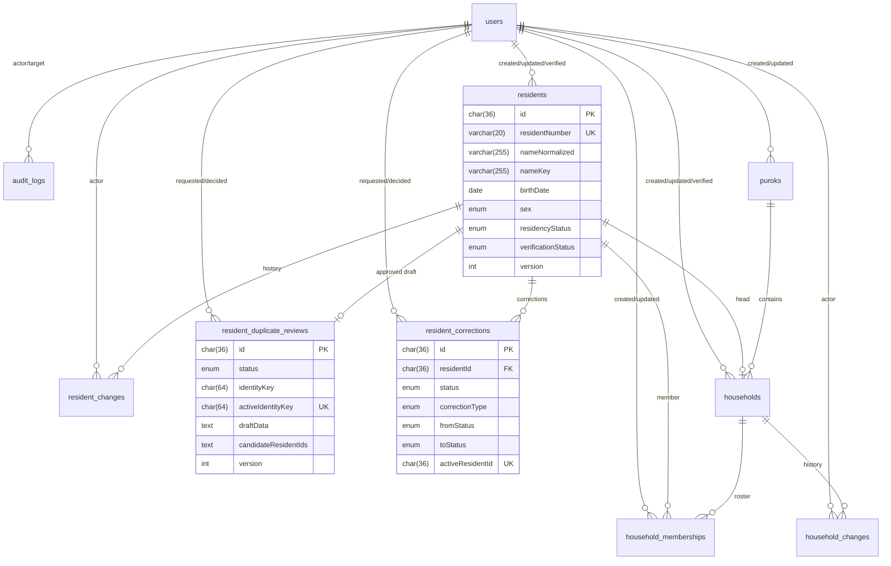

# Database and Prisma

**Engine:** MySQL 8 / MariaDB 10.11+ (local verification on MariaDB 12.3)
**ORM:** Prisma 6.19
**Migrations:** `20261028120000_init`, `20261028130000_residents_phase2`,
`20261028140000_households_phase3`

---

## 1. Scope

Phase 1 stores authentication, authorization, sessions, and audit data. Phase 2
adds resident records, change history, resident-number allocation, duplicate
review, and deceased-status correction. Phase 3 adds Puroks, households,
membership history, and household numbering. Certificate and import tables
remain absent until their phases are approved.

All tables are MariaDB/MySQL compatible. Structured values are stored as JSON
strings in `TEXT`; no JSON column type, generated column, functional index, or
CHECK constraint is used.

---

## 2. Phase 1 models

### `users`

| Column                | Type           | Notes                                              |
| --------------------- | -------------- | -------------------------------------------------- |
| `id`                  | CHAR(36)       | UUID primary key                                   |
| `username`            | VARCHAR(64)    | Unique, stored lowercase                           |
| `email`               | VARCHAR(191)   | Unique, contact/recovery identifier                |
| `passwordHash`        | VARCHAR(255)   | bcrypt hash, never returned by the API             |
| `firstName`           | VARCHAR(80)    |                                                    |
| `middleName`          | VARCHAR(80)    | Nullable                                           |
| `lastName`            | VARCHAR(80)    |                                                    |
| `role`                | ENUM           | `SYSTEM_ADMIN`, `BARANGAY_SECRETARY`, `BARANGAY_ENCODER`, `BARANGAY_CAPTAIN` |
| `status`              | ENUM           | `ACTIVE`, `INACTIVE`                               |
| `failedLoginAttempts` | INT            | Reset on successful sign-in                        |
| `lockedUntil`         | DATETIME(3)    | Nullable; temporary lockout window                 |
| `lastLoginAt`         | DATETIME(3)    | Nullable                                           |
| `passwordChangedAt`   | DATETIME(3)    | Defaults to creation time (ready for reset flows)  |
| `createdAt`           | DATETIME(3)    |                                                    |
| `updatedAt`           | DATETIME(3)    | Prisma-managed                                     |

Indexes: `username` unique, `email` unique, `(role, status)`, `(status)`.

### `sessions`

| Column      | Type         | Notes                                      |
| ----------- | ------------ | ------------------------------------------ |
| `id`        | CHAR(36)     | UUID primary key                           |
| `sid`       | VARCHAR(191) | Unique session identifier (indexed)        |
| `data`      | TEXT         | Serialized express-session payload         |
| `expiresAt` | DATETIME(3)  | Indexed; pruned periodically               |
| `createdAt` | DATETIME(3)  |                                            |
| `updatedAt` | DATETIME(3)  | Prisma-managed                             |

The payload includes `userId` and `csrfToken`; it never stores a password or
resident data.

### `audit_logs`

| Column         | Type         | Notes                                            |
| -------------- | ------------ | ------------------------------------------------ |
| `id`           | CHAR(36)     | UUID primary key                                 |
| `actorUserId`  | CHAR(36)     | Nullable FK to users, `ON DELETE SET NULL`       |
| `targetUserId` | CHAR(36)     | Nullable FK to users, `ON DELETE SET NULL`       |
| `action`       | VARCHAR(64)  | e.g. `RESIDENT_PROFILE_VIEWED`                   |
| `entityType`   | VARCHAR(64)  | e.g. `Resident`, `ResidentDuplicateReview`       |
| `entityId`     | VARCHAR(64)  | Affected record ID                               |
| `ipAddress`    | VARCHAR(45)  | IPv4/IPv6 textual form                           |
| `userAgent`    | VARCHAR(255) | Truncated                                        |
| `metadata`     | TEXT         | JSON string; MUST NOT contain secrets            |
| `createdAt`    | DATETIME(3)  | Indexed with action and actor                    |

Indexes: `(action, createdAt)`, `(actorUserId, createdAt)`, `(createdAt)`.

---

## 3. Phase 2–3 operational models

### Phase 2 resident models

### `residents`

| Column | Type | Notes |
| ------ | ---- | ----- |
| `id` | CHAR(36) | UUID primary key |
| `residentNumber` | VARCHAR(20) | Unique, `RES-YYYY-NNNNNN` |
| `firstName`, `lastName` | VARCHAR(80) | Required |
| `middleName` | VARCHAR(80) | Nullable |
| `suffix` | VARCHAR(20) | Nullable; Jr./Sr./II–V |
| `nameNormalized` | VARCHAR(255) | Accent/case/punctuation-normalized full name |
| `nameKey` | VARCHAR(255) | Normalized first + last name |
| `birthDate` | DATE | Date-only to avoid timezone drift |
| `sex` | ENUM | `MALE`, `FEMALE`, `NOT_RECORDED` |
| `contactNumber` | VARCHAR(20) | Nullable PH mobile number |
| `residencyStatus` | ENUM | `ACTIVE`, `MOVED_OUT`, `DECEASED`, `INACTIVE` |
| `statusChangedAt` | DATETIME(3) | Updated on status transition |
| `recordSource` | ENUM | `WALK_IN`, `FIELD_SURVEY`, `EXISTING_RECORD`, `IMPORT` |
| `sourceReference` | VARCHAR(150) | Nullable source citation |
| `sourceReferenceUnavailableReason` | VARCHAR(500) | Nullable legacy/import justification |
| `verificationStatus` | ENUM | `UNVERIFIED`, `VERIFIED` |
| `verifiedAt` | DATETIME(3) | Nullable |
| `verifiedByUserId` | CHAR(36) | Nullable FK to users, `SET NULL` |
| `version` | INT | Optimistic concurrency token, starts at 1 |
| `createdByUserId` | CHAR(36) | Nullable FK to users, `SET NULL` |
| `updatedByUserId` | CHAR(36) | Nullable FK to users, `SET NULL` |
| `createdAt`, `updatedAt` | DATETIME(3) | UTC |

Indexes: `(nameNormalized, birthDate)`, `(nameKey, birthDate)`,
`(lastName, firstName, birthDate)`, `(residencyStatus, lastName)`,
`(verificationStatus)`, `(updatedAt)`. `residentNumber` is unique.

### `resident_changes`

| Column | Type | Notes |
| ------ | ---- | ----- |
| `id` | CHAR(36) | UUID primary key |
| `residentId` | CHAR(36) | FK to residents, `RESTRICT` |
| `actorUserId` | CHAR(36) | Nullable FK to users, `SET NULL` |
| `action` | ENUM | `CREATED`, `UPDATED`, `STATUS_CHANGED`, `VERIFIED`, duplicate/correction actions, `STATUS_CORRECTED` |
| `changes` | TEXT | JSON array of `{field, before, after}` |
| `reason` | VARCHAR(500) | Nullable |
| `createdAt` | DATETIME(3) | UTC |

Indexes: `(residentId, createdAt)`, `(actorUserId, createdAt)`. History rows are
append-only in application code.

### `resident_number_sequences`

| Column | Type | Notes |
| ------ | ---- | ----- |
| `year` | INT | Primary key, e.g. `2026` |
| `lastNumber` | INT | Last allocated sequence number |
| `updatedAt` | DATETIME(3) | Prisma-managed |

Rows are allocated with an atomic insert-on-duplicate-key update at
`READ COMMITTED` isolation. Resident numbers are
`RES-{year}-{lastNumber padded to 6}`.

### `resident_identity_guards`

| Column | Type | Notes |
| ------ | ---- | ----- |
| `identityKey` | CHAR(64) | Primary key; SHA-256 of normalized first+last+birthdate |
| `createdAt` | DATETIME(3) | UTC |

This table enforces at most one live resident per identity under concurrency.
The key is derived, never reversible, and is not exposed by the API.

### `resident_duplicate_reviews`

| Column | Type | Notes |
| ------ | ---- | ----- |
| `id` | CHAR(36) | UUID primary key |
| `status` | ENUM | `PENDING`, `APPROVED`, `REJECTED`, `CANCELLED` |
| `identityKey` | CHAR(64) | Candidate identity |
| `activeIdentityKey` | CHAR(64) | Unique while pending; cleared after decision |
| `requestedByUserId` | CHAR(36) | Nullable FK to users, `SET NULL` |
| `decidedByUserId` | CHAR(36) | Nullable FK to users, `SET NULL` |
| `draftData` | TEXT | JSON resident draft; cleared after decision |
| `candidateResidentIds` | TEXT | JSON array of `{id, matchType}` |
| `reason` | VARCHAR(500) | Required submission reason |
| `decisionNote` | VARCHAR(500) | Nullable until decided |
| `createdResidentId` | CHAR(36) | Unique nullable FK; set on approval |
| `version` | INT | Decision concurrency token |
| `createdAt`, `updatedAt`, `decidedAt` | DATETIME(3) | UTC |

Indexes: `(status, createdAt)`, `(identityKey, status)`,
`(requestedByUserId, createdAt)`. `activeIdentityKey` and `createdResidentId`
are unique to prevent concurrent duplicate approvals.

### `resident_corrections`

| Column | Type | Notes |
| ------ | ---- | ----- |
| `id` | CHAR(36) | UUID primary key |
| `residentId` | CHAR(36) | FK to residents, `RESTRICT` |
| `status` | ENUM | `PENDING`, `APPROVED`, `REJECTED`, `CANCELLED` |
| `correctionType` | ENUM | `STATUS_REVERSAL` |
| `fromStatus`, `toStatus` | ENUM | Captured at request time |
| `reason` | VARCHAR(500) | Required |
| `evidenceReference` | VARCHAR(255) | Required documentary reference |
| `requestedByUserId` | CHAR(36) | Nullable FK to users, `SET NULL` |
| `decidedByUserId` | CHAR(36) | Nullable FK to users, `SET NULL` |
| `decisionNote` | VARCHAR(500) | Nullable until decided |
| `activeResidentId` | CHAR(36) | Unique while pending; one open correction per resident |
| `version` | INT | Decision concurrency token |
| `createdAt`, `updatedAt`, `decidedAt` | DATETIME(3) | UTC |

Indexes: `(status, createdAt)`, `(residentId, createdAt)`,
`(requestedByUserId, createdAt)`. `activeResidentId` is unique while pending.

### Phase 3 Purok and household models

#### `puroks`

| Column | Type | Notes |
| ------ | ---- | ----- |
| `id` | CHAR(36) | UUID primary key |
| `code` | VARCHAR(20) | Unique, uppercase, 2–20 characters |
| `name` | VARCHAR(120) | Display name |
| `nameNormalized` | VARCHAR(160) | Unique normalized name for duplicate prevention |
| `status` | ENUM | `ACTIVE`, `INACTIVE` |
| `version` | INT | Optimistic concurrency token |
| `createdByUserId`, `updatedByUserId` | CHAR(36) | Nullable FKs to users, `SET NULL` |
| `createdAt`, `updatedAt` | DATETIME(3) | UTC |

Indexes: `(status, name)`, `(updatedAt)`. A Purok cannot be deactivated while
it has active households.

#### `households`

| Column | Type | Notes |
| ------ | ---- | ----- |
| `id` | CHAR(36) | UUID primary key |
| `householdNumber` | VARCHAR(20) | Unique, immutable `HH-YYYY-NNNNNN` |
| `purokId` | CHAR(36) | FK to Puroks, `RESTRICT` |
| `addressLine` | VARCHAR(255) | Required |
| `landmark` | VARCHAR(200) | Nullable; hidden from Captain |
| `headResidentId` | CHAR(36) | Unique nullable FK to residents, `RESTRICT` |
| `status` | ENUM | `ACTIVE`, `INACTIVE` |
| `statusChangedAt` | DATETIME(3) | UTC |
| `verificationStatus` | ENUM | `UNVERIFIED`, `VERIFIED` |
| `verifiedAt` | DATETIME(3) | Nullable |
| `verifiedByUserId` | CHAR(36) | Nullable FK to users, `SET NULL` |
| `version` | INT | Optimistic concurrency token |
| `createdByUserId`, `updatedByUserId` | CHAR(36) | Nullable FKs to users, `SET NULL` |
| `createdAt`, `updatedAt` | DATETIME(3) | UTC |

Indexes: `(purokId, status)`, `(status, householdNumber)`,
`(verificationStatus)`, `(updatedAt)`. The unique `headResidentId` prevents one
resident from heading multiple households. Household numbers are allocated
atomically and never reused.

#### `household_memberships`

| Column | Type | Notes |
| ------ | ---- | ----- |
| `id` | CHAR(36) | UUID primary key |
| `householdId` | CHAR(36) | FK to households, `RESTRICT` |
| `residentId` | CHAR(36) | FK to residents, `RESTRICT` |
| `activeResidentId` | CHAR(36) | Unique nullable resident ID while active |
| `relationship` | VARCHAR(80) | Nullable |
| `status` | ENUM | `ACTIVE`, `ENDED` |
| `joinedAt` | DATETIME(3) | UTC |
| `endedAt` | DATETIME(3) | Nullable |
| `endReason` | ENUM | `LEFT_HOUSEHOLD`, `MOVED_OUT`, `DECEASED`, `TRANSFERRED`, `HOUSEHOLD_DISSOLVED`, `OTHER` |
| `endNote` | VARCHAR(500) | Nullable; required for `OTHER` |
| `version` | INT | Membership concurrency token |
| `createdByUserId`, `updatedByUserId` | CHAR(36) | Nullable FKs to users, `SET NULL` |
| `createdAt`, `updatedAt` | DATETIME(3) | UTC |

Indexes: `(householdId, status, createdAt)`, `(residentId, status)`,
`(status, endedAt)`. The unique `activeResidentId` enforces one active
household membership per resident. Ended rows are retained as history.

#### `household_changes`

| Column | Type | Notes |
| ------ | ---- | ----- |
| `id` | CHAR(36) | UUID primary key |
| `householdId` | CHAR(36) | FK to households, `RESTRICT` |
| `actorUserId` | CHAR(36) | Nullable FK to users, `SET NULL` |
| `action` | ENUM | `CREATED`, `UPDATED`, `STATUS_CHANGED`, `VERIFIED`, `HEAD_CHANGED`, `MEMBER_ADDED`, `MEMBER_ENDED`, `MEMBER_TRANSFERRED`, `MEMBER_STATUS_CHANGED` |
| `changes` | TEXT | JSON object of changed values |
| `reason` | VARCHAR(500) | Nullable |
| `createdAt` | DATETIME(3) | UTC |

Indexes: `(householdId, createdAt)`, `(actorUserId, createdAt)`. Rows are
append-only in application code.

#### `household_number_sequences`

| Column | Type | Notes |
| ------ | ---- | ----- |
| `year` | INT | Primary key |
| `lastNumber` | INT | Last allocated sequence number |
| `updatedAt` | DATETIME(3) | Prisma-managed |

Allocation uses an atomic insert-on-duplicate-key update at `READ COMMITTED`
isolation. Household numbers are `HH-{year}-{lastNumber padded to 6}`.

---

## 4. ERD



There is intentionally no FK from `sessions` to `users`: express-session owns
the row, and the authoritative link is `userId` inside the serialized payload.
`loadCurrentUser` validates that link against `users` on every request.

---

## 5. Migration workflow

Committed migrations are the source of truth.

```bash
# Apply pending migrations (development, staging, production)
npm --prefix backend run db:migrate

# Create a new migration after editing schema.prisma
cd backend
npx prisma migrate dev --name describe_the_change
```

The test suite applies committed migrations in `tests/global-setup.ts` and
refuses a URL that is not a `_test` database. The development and test databases
have had all three migrations applied. If `prisma migrate dev` fails against a
restricted MariaDB user with shadow-database errors (`P3014`/`P1010`), generate
SQL with `prisma migrate diff`, execute it with `prisma db execute`, then mark
it applied with `prisma migrate resolve --applied`; test databases still use
`prisma migrate deploy`. `db:push` is only for quick local iteration and must
not be used against production.

---

## 6. Data conventions

- **Timestamps:** stored in UTC by Prisma, presented in `Asia/Manila` by the
  frontend. `birthDate` is a `DATE` and is parsed/formatted as UTC date-only.
- **Identifiers:** UUID v4 (`CHAR(36)`) for application records. Resident
  numbers are human-facing and separate from UUIDs.
- **Normalization:** names are NFKD-normalized, combining marks removed,
  lowercased, punctuation collapsed, and whitespace trimmed. Normalized values
  drive search and duplicate matching, not display.
- **Concurrency:** resident, review, correction, Purok, household, and
  membership edits use `version`. Transactions run at `READ COMMITTED`, lock
  affected rows in the canonical order, and retry lock/deadlock failures a
  bounded number of times. Yearly number sequences use atomic SQL allocation.
- **Deletion:** residents, households, memberships, corrections, and history
  use `RESTRICT`/status transitions; users linked to records are `SET NULL`.
  There is no hard-delete endpoint for resident or household data.
- **PII minimization:** full-profile and history reads are audited. Directory
  and lookup responses omit contact details and source-reference fields.
  Audit metadata records IDs, changed field names, and decisions; not passwords,
  session IDs, CSRF tokens, or full resident payloads.
- **Legacy provenance:** `EXISTING_RECORD` and `IMPORT` require a source
  reference or a documented reason it is unavailable.
- **Seed data:** six synthetic residents (`RES-2026-000001`–`000006`), four
  Puroks, three households, and the `2026` sequence rows are created only by
  `db:seed`, which refuses production. The seed is idempotent.

---

## 7. Backup, retention, and production notes

Not yet implemented; required before go-live:

- Daily encrypted database backups with restore drills.
- An audit and resident-retention policy approved by the barangay (minimum
  retention to be confirmed with records management and legal counsel).
- Log rotation for application logs.
- A decision on audit immutability. The current table is writable by a database
  administrator; tamper-evident storage or offsite shipping is a later step.
- Capacity planning. Barangay-scale data is small, but session rows must be
  pruned (the server does this every 15 minutes).
- Indexed search review as the directory grows; current indexes target name,
  birth date, status, verification, and update recency.

---

## 8. Future schema outline (not implemented)

These are planning notes only. Do not create these tables until the relevant
phase is approved.

- `certificate_types` — barangay-defined certificate catalogue and templates.
- `certificate_requests` — requester, purpose, status history, approver.
- `certificate_issuances` — control number, issued by, issued at, reprint flag.
- `import_batches` / `import_rows` — controlled Excel/CSV intake, validation
  results, provenance, and rollback status.
- `settings` — barangay profile, signatories, certificate numbering.

Design constraints for those phases:

- Soft-delete or status transitions instead of hard deletion for records with
  legal retention requirements.
- Every mutation that affects a resident or certificate must write an audit
  record with actor, before/after summary, and correlation ID.
- Imported rows must retain their source file, row number, and validation
  outcome for reconciliation.
- Do not store national ID numbers unless a documented legal basis and
  retention rule exist.
